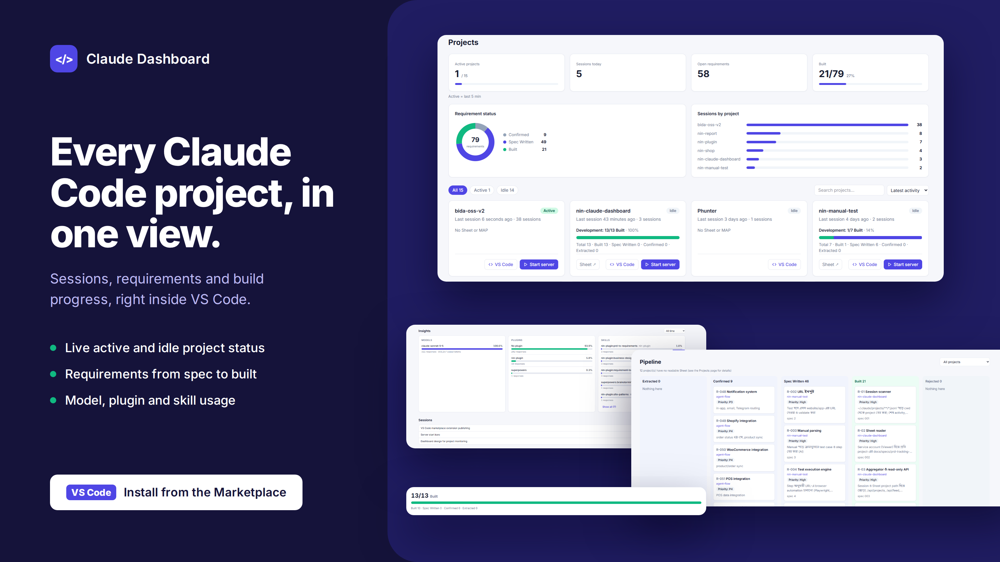
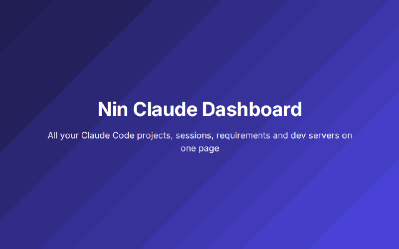

# A VS Code Extension to Track Your Claude Code Projects, Sessions and Dev Servers

**Subtitle:** Nin Claude Dashboard shows which session ran where, which server holds which port, and how far each requirement has come, without leaving VS Code.





## Install the VS Code extension

**Nin Claude Dashboard** is a VS Code extension. Install it from the [VS Code Marketplace](https://marketplace.visualstudio.com/items?itemName=NazmulIslamNaim.nin-claude-dashboard), then run **Claude Dashboard: Open** from the command palette. The dashboard opens inside VS Code, next to your code. Google Sheets are optional: without one it reads `MAP.md`.

Prefer a browser tab? The same dashboard also runs as a small local server, see [How to run it without the extension](#how-to-run-it-without-the-extension) below.

## The problem

Once you run Claude Code on a few projects in parallel, things start to slip:

- Which project had a session recently, and when?
- Laravel, FastAPI and `npm run dev` all want the same port. Who is holding it?
- Requirement status lives in a Google Sheet, the code in VS Code, and I can never remember which plugins are on for which project.

I kept digging through terminals to answer these. So I built a small local dashboard for myself, and then packaged it as a VS Code extension.

## What it gives you

- **Projects page:** Claude Code sessions per project, read from `~/.claude/projects`, with the active ones marked.
- **Requirement status:** read from each project's own Google Sheet, or from a `MAP.md` file if you have no Sheet.
- **Servers on fixed ports:** Laravel, Django, FastAPI, npm `dev`/`start`. Type a port and press Enter to keep it, then Start and Stop from the card. If something else holds the port, the start is blocked and the message tells you who.
- **Plugin switch:** turn Claude plugins on or off per project. Only that project's `settings.local.json` changes, and nothing is uninstalled.
- **Open in VS Code:** one button on each card.
- **LAN access (optional):** with a token, you can open it from your phone on the same Wi-Fi.

## Where the requirements come from: nin-plugin

The requirement status comes from my other Claude Code plugin, **nin-plugin**. Its `requirement-to-spec` skill turns a requirement into an instruction file and a spec, and writes `docs/specs/MAP.md`. Its `prd-to-requirements` skill puts requirements into a Google Sheet and stores the Sheet URL in `docs/specs/prd-tracking-sheet.txt`. The dashboard only reads those two files.

To try it:

```
/plugin marketplace add Nazmul-Islam-Naim/nin-plugin
/plugin install nin-plugin@nin-plugin
/reload-plugins
```

The dashboard also works without nin-plugin. Sessions, Servers and Plugins all work; only the requirement progress stays empty, unless you write a `MAP.md` by hand.

## How to run it without the extension

**1. Build and install**

```
cd web && npm install && npm run build
cd ../server && npm install
```

**2. Connect Google Sheets (optional)**

Create a service account in Google Cloud and put the path of its key file in `server/.env`:

```
GOOGLE_APPLICATION_CREDENTIALS=<path to the key .json>
```

Share each project's Sheet with the service account's email (Viewer is enough), and put the Sheet URL in that project's `docs/specs/prd-tracking-sheet.txt`.

**3. Start it**

```
cd server && npm start
```

Then open `http://127.0.0.1:47615` in your browser.

## What changed for me

- Less context switching: every project on one page.
- No more port clashes: each service keeps the port I gave it.
- No plugin guesswork: each project only has the plugins it needs.
- Requirements sit next to the code.

## Feedback

If you have feedback or an idea, open an issue on GitHub.

**Repo:** https://github.com/Nazmul-Islam-Naim/nin-claude-dashboard

---
Tags: Claude Code, VS Code, Developer Tools, Productivity, Open Source
